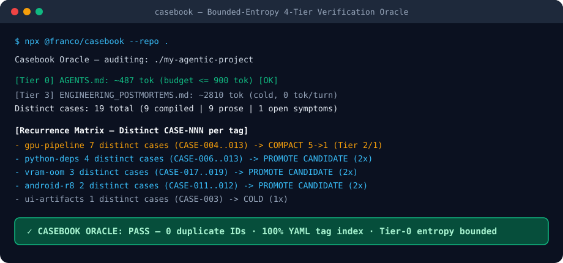

# Casebook (`@franco/casebook`)

[](https://github.com/JavierFrancoLeal/casebook/actions/workflows/ci.yml)
[](./LICENSE)

**Bounded-entropy 4-tier constitutional memory for AI coding agents.**  
*By [Javier Franco](https://github.com/JavierFrancoLeal) · `v1.0.0` · Apache-2.0*

> **"The world verifies the verifier."** — *Reality verifies the rule.*  
> 📖 **Read the field-notes essay:** [Reality Verifies the Rule (Wan2.2, Android R8 & Wittgenstein)](./docs/ESSAY_REALITY_VERIFIES_THE_RULE.md)



---

## The Problem: Context Entropy & Agent Bureaucracy

Every time an AI coding agent hits a painful bug, the reflex is to append another paragraph to `AGENTS.md`, `CLAUDE.md`, or `GEMINI.md`. After 50 bugs, your always-loaded prompt becomes a heavy, contradictory bureaucratic filter — burning thousands of tokens per turn while agents still ignore buried prose.

**Casebook** solves this with a 4-tier architecture inspired by **constitutional jurisprudence** and **compiler design**:

| Tier | Legal Equivalent | Where It Lives | Daily Token Cost | Entropy Rule |
| :--- | :--- | :--- | :--- | :--- |
| **Tier 0 — Constitution** | National Constitution | `AGENTS.md` / global constitution | Always loaded (**hard cap `<= 900 tok` repo / `<= 1,500 tok` total**) | Abstract universal invariants only. **Never** add vendor bugs here. |
| **Tier 1 — Domain Skills** | Penal / Commercial Code | `.agents/skills/<domain>/SKILL.md` | **Lazy-loaded** (`0 tok` when idle) | Scoped strictly to one tool or craft. |
| **Tier 2 — Compiled Law** | Physical lock / traffic light | Tests, `assert`s, linters, CI guards, hooks | **`0 tokens` in prompt** (100 % mechanical) | Preferred destination: once compiled to code, collapse prose to 1 line. |
| **Tier 3 — Cold Case-Law & Open Symptoms Radar** | Court Archive + Open Docket | `docs/ENGINEERING_POSTMORTEMS.md` | **Never auto-loaded** (`grep` on failure only) | Structured `CASE-001..N` with YAML `tags` + `error_strings` index. |

---

## Two Orthogonal Axes: Transferability × Recurrence

1. **Transferability decides WHERE a lesson lives (3-question filter):**
   - Disappears if you swap the vendor/library? → **`vendor-quirk`** → Tool Skill (Tier 1).
   - Survives vendor swap, stays within one craft? → **`class-pattern`** → Craft Skill (Tier 1).
   - Law of physics, math, or computing (e.g., *compile != execute*)? → **`universal-invariant`** → Constitution (Tier 0).
   - None of the above? You have a **symptom, not a root cause** → log it in **`## Open Symptoms Radar` (`status: open`)** so future projects can match it by `error_string` or `tag`.
2. **Recurrence decides WHEN a lesson promotes (distinct `CASE-NNN` count):**
   - **`1×` incident:** Stays cold in Tier 3 (`0 tok/turn`).
   - **`2×` distinct incidents:** Promote to an executable **Tier 2 test/assert/hook** (preferred) or Tier 1 Skill.
   - **`5×` distinct incidents on the same `tag`:** Mandatory **`5 → 1` Compaction**.

---

## Quick Start (1 Command, Zero Dependencies)

### Install as an Antigravity Plugin
```bash
git clone https://github.com/JavierFrancoLeal/casebook.git ~/.gemini/config/plugins/casebook
```

### Run the Verification Oracle in Any Repository (Node `>= 18`)
```bash
node ~/.gemini/config/plugins/casebook/skills/casebook/scripts/verify-casebook.mjs --repo .
```

### Run the Test Suite
```bash
npm test
```

---

## Open-Source Agent Engineering Trilogy

| Flagship | Role | Status |
| :--- | :--- | :--- |
| **[`casebook`](https://github.com/JavierFrancoLeal/casebook)** | Bounded-entropy 4-tier memory, Open Symptoms Radar & executable oracle | **`v1.0.0` Live** |
| **`dual-brain-guard`** | Harness-agnostic mechanical cross-model verification (`CLI + MCP + hooks`) | Next (Phase B) |
| **`autonomy-ladder`** | Evidence-based Traffic-Light autonomy grader (`🟢 / ⚑ / 🟡 / 🔴`) | Planned (Phase C) |

---

## License

Apache License 2.0 — see [LICENSE](./LICENSE).
